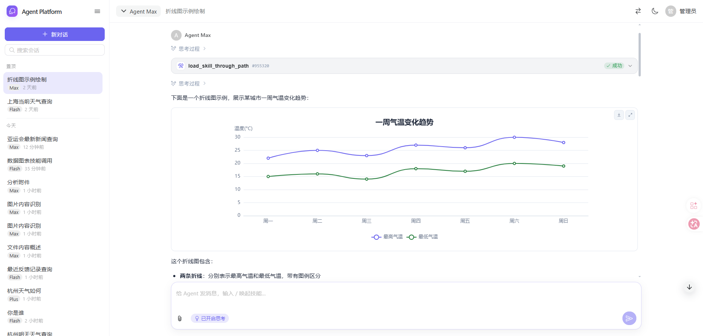

# agent-scope-java-demo

Agent + MCP 演示工程：基于 [AgentScope Java](https://github.com/agentscope-ai/agentscope-java) Harness 构建三档智能体服务，通过 MCP（Streamable HTTP）调用工具服务。



## 模块说明

| 模块 | 端口 | 说明 |
| --- | --- | --- |
| `mcp-server` | 8081 | Spring AI MCP Server（STREAMABLE 协议），示例工具：当前时间、天气查询（wttr.in 免费接口） |
| `agent-app` | 8082 | AgentScope HarnessAgent 智能体服务：SSE 流式对话、Sa-Token + MyBatis-Plus 登录（MySQL 存用户、Redis 存 token）、会话状态落库、token 用量统计、管理后台接口 |
| `agent-ui` | 5173 | 手写样式版对话界面（Vite + Vue 3 + Pinia + Axios） |
| `naive-agent-ui` | 5174 | Naive UI 版对话界面（同一套后端接口，UnoCSS 辅助样式） |

## 三档 Agent

| 档位 | 模型 | 思考 | 工具/MCP | 技能 | 附件 |
| --- | --- | --- | --- | --- | --- |
| flash（默认） | qwen3.7-flash | ✗ | ✓ | ✓ | ✗ |
| plus | qwen3.7-plus | ✓ | ✓ | ✓ | ✗ |
| max | qwen3.7-max | ✓ | ✓ | ✓ | ✓ |

本地注册工具：MySQL 只读查询（`MysqlQueryTools`）、数据导出 CSV（`DataExportTools`）。技能市场在 `agent-app/src/main/resources/skills/<name>/SKILL.md`（sql-query、data-chart、weather-report、translate），输入框输入 `/` 唤出。管理员可在用户管理中为每个用户配置可用档位白名单（管理员不受限）。

## 环境要求

- JDK 17+、Maven 3.6+、Node + pnpm
- DashScope API Key（环境变量 `YOKA_DASHSCOPE_API_KEY`）
- MySQL 8（`localhost:3306`，初始化脚本 `sql/init.sql`）
- Redis（`localhost:6379`，存登录 token）

## 启动方式

```bash
# 1. 初始化数据库（建库 agent_demo + 全部表 + 种子用户 admin/admin123）
mysql -h127.0.0.1 -uroot -p < sql/init.sql

# 2. 启动 MCP server（8081）
mvn -pl mcp-server spring-boot:run

# 3. 启动 Agent 服务（8082）
export YOKA_DASHSCOPE_API_KEY=sk-xxxx
mvn -pl agent-app spring-boot:run

# 4. 启动前端（agent-ui 5173 或 naive-agent-ui 5174，二选一）
cd agent-ui && pnpm install && pnpm dev
```

浏览器打开 `http://localhost:5173`（或 5174），用 **admin / admin123** 登录。前端经 Vite 代理转发 `/agent/**`、`/auth/**`、`/user/**` 到 8082，无需处理跨域。

## 主要接口

| 能力 | 接口 |
| --- | --- |
| 登录、退出、当前用户 | `POST /auth/login`、`POST /auth/logout`、`GET /auth/current` |
| 流式对话（SSE） | `POST /agent/scope/chat_sse` |
| 中断生成 | `POST /agent/scope/interrupt` |
| 会话列表/新建/删除/置顶/历史消息 | `GET getSessions`、`POST createSession`、`POST delSession`、`POST pinSession`、`GET getMessages`（前缀 `/agent/scope`） |
| Agent 档位与技能列表 | `GET /agent/scope/agents`、`GET /agent/scope/skills` |
| 附件上传、导出文件下载（签名链接） | `POST /agent/scope/files/upload`、`GET /agent/scope/files/download/{fileName}` |
| 消息反馈 | `POST /agent/scope/feedback`、`GET /agent/scope/getFeedbacks` |
| 个人中心用量统计 | `GET /agent/scope/usage/summary`、`GET /agent/scope/usage/recent`（分页） |
| 个人资料/密码/意见反馈 | `PUT /user/profile`、`PUT /user/password`、`POST /user/feedback/submit` |
| 管理后台（仅 admin）：用户管理、操作日志、反馈处理 | `/user/manage/**` |

流式事件类型与报文示例见根目录 `流式接口请求示例.txt`；API 文档启动后访问 `http://localhost:8082/doc.html`（Knife4j）。

curl 快速验证：

```bash
# 登录拿 token
curl -X POST http://localhost:8082/auth/login \
  -H "Content-Type: application/json" \
  -d '{"account":"admin","password":"admin123"}'

# 流式对话（用户身份由 token 解析）
curl -N -X POST http://localhost:8082/agent/scope/chat_sse \
  -H "Content-Type: application/json" \
  -H "Authorization: Bearer <token>" \
  -d '{"sessionId":"s1","message":"查询一下杭州今天的天气","agentName":"max"}'
```

## 说明

- 登录态由 Sa-Token 存 Redis（7 天），前端 token 存 localStorage，401 自动回登录页；接口用户身份一律由后端从 token 解析。
- 会话标题：新建时先写「新会话」占位，首条消息后异步生成正式标题。
- token 用量：每次模型调用由 `TokenUsageMiddleware` 落库 `t_token_usage`，费用按写入时单价锁定（`application.yaml` 的 `usage.*`），个人中心展示汇总/分桶图表与分页请求记录。
- 开启思考模式的档位，输入框旁显示「已开启思考」只读标识；流式事件含 `thinking` 增量与工具调用状态（`success/error/interrupted/denied`）。
- 会话导出：顶栏 ⋯ 菜单可导出当前会话为 Markdown / HTML / PDF（PDF 走浏览器打印）。
- 智能体状态落库 `agentscope_sessions`（MysqlAgentStateStore），按 `userId:sessionId` 槽位隔离；工具权限模式为 `PermissionMode.BYPASS`，仅供演示。

可选环境变量：

| 变量 | 默认 | 说明 |
| --- | --- | --- |
| `YOKA_DASHSCOPE_API_KEY` | 无（必填） | DashScope API Key |
| `MYSQL_PASSWORD` | `root` | MySQL 密码 |
| `MCP_SERVER_TOKEN` | 空 | MCP server 访问令牌，为空不校验 |
| `AGENT_FLASH_MODEL` / `AGENT_PLUS_MODEL` / `AGENT_MAX_MODEL` | qwen3.7-flash / plus / max | 三档主模型名 |
